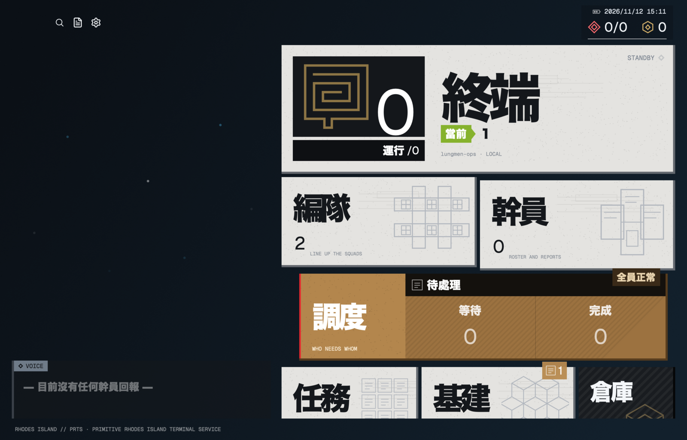
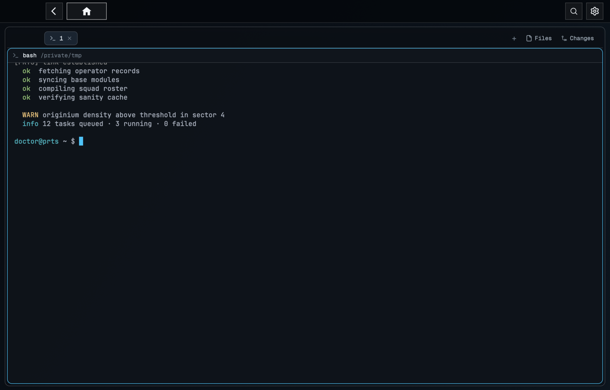
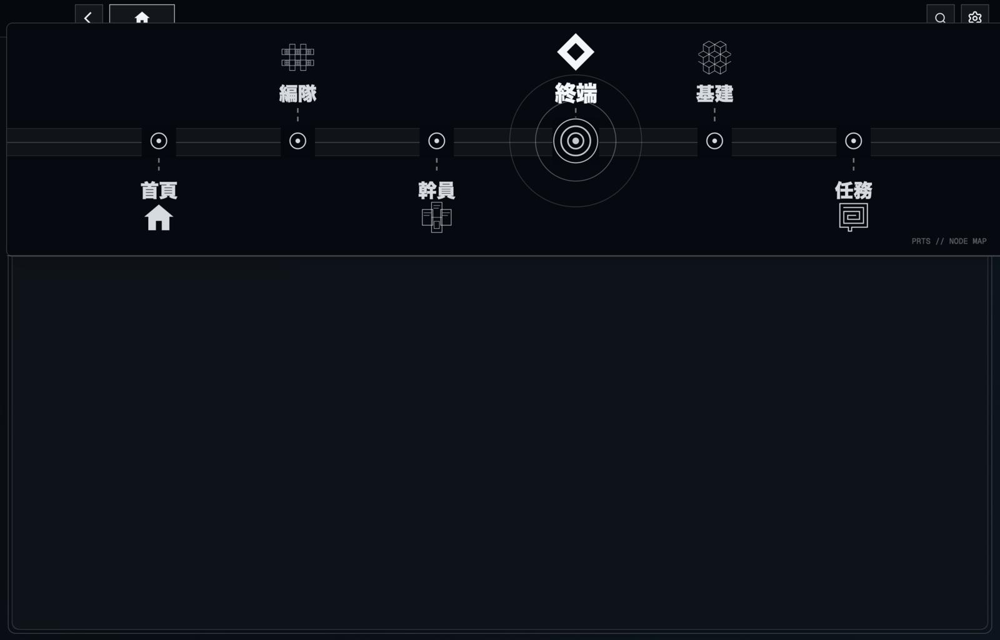

# PRTS layout for Herdr

A two-screen [Herdr](https://herdr.dev) layout inspired by the operator terminal UI of a tactical mobile game: a HOME screen of flat frosted tiles, and a TERMINAL screen with one large translucent terminal and a drop-down node map.



| TERMINAL | Node map (`cmd-;`) |
|---|---|
|  |  |

## Install

```sh
git clone https://github.com/miyago9267/herdr-layout-prts
cd herdr-layout-prts
cp layouts/prts.json layouts/prts.svg ~/.config/herdr-app/layouts/
cp themes/prts.json ~/.config/herdr-app/themes/
cp -R mods/prts mods/prts-spaces mods/prts-agents ~/.config/herdr-app/mods/
herdr-app do layout.switch '{"name":"prts"}'
```

Then merge `keys.json` into `~/.config/herdr-app/keys.json` (it adds a `layout:prts` section: `cmd-.` toggles HOME / TERMINAL, `cmd-;` opens the node map).

Optional: put your own wallpaper at `~/.config/herdr-app/backgrounds/prts-operator.jpg` (16:10, subject on the left). Without it a dark gradient shows.

What the mods touch: `prts-spaces` (copied from Herdr's `spaces`) runs `git status` / `git rev-parse` in each space's folder, watches the repo folder for changes, and calls `hc machine ls` for the machine list. Nothing makes network requests.

## Notes

- Made for macOS (titles use the system font Hiragino Sans W8). See [RECIPE.md](RECIPE.md) for how it is built and what to change elsewhere.
- `mods/prts-spaces` and `mods/prts-agents` are modified copies of Herdr's shipped `spaces` and `agents` mods (Apache-2.0).
- Fan-made and unofficial. Not affiliated with or endorsed by Hypergryph or Yostar. No game art, logos or fonts are included.

## License

Apache-2.0
