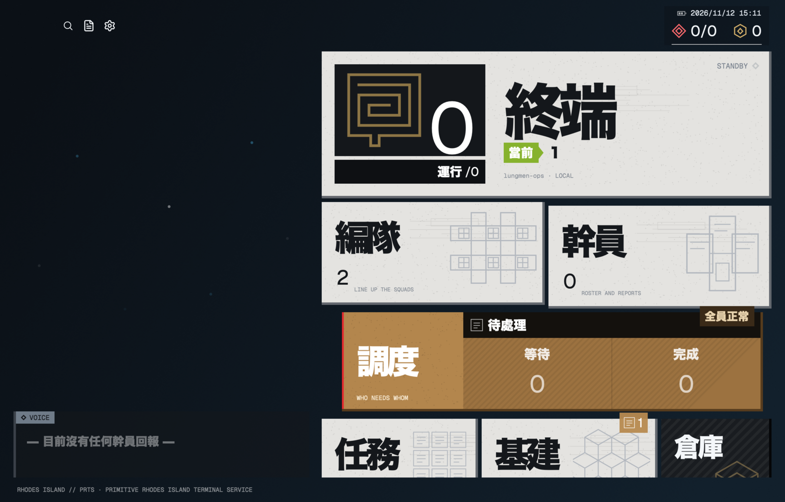

# PRTS

A Herdr layout styled after a tactical-game operator terminal: a HOME screen of flat, square, frosted-white tiles that summarize your spaces and agents, and a TERMINAL screen where one large translucent terminal fills the window. A node map drops down from the house button to jump between the two and open the side lists. Dark background, One Dark terminal colors, ice-blue accent.

## What you see

**TERMINAL** (shown at launch)
- Top bar, 48px, `#04070bd2`: back arrow (36px square) and house button (84x36, white 1px border) at left; command palette and settings squares at right. The bar drags the window.
- Below it, 8px/10px padding: one rounded console (radius 10, `#0b0f1552`, 1px `#ffffff33`) holding the shipped `tabs` bar (40px) and the active tab's panes (`terminal_opacity` 0.45, pane header on hover).
- Hidden until opened: a 340px drawer at left (spaces list or agents list) and a 368px right panel (shipped `files` / `changes`).
- Node map popup, full width, 300px, `#05080eeb`, under the bar: a horizontal spine (36px band `#ffffff0a` with a 1px line at 152px) carrying six nodes 150px wide, 28px apart: 首頁 (home), 編隊 (squads), 幹員 (operators), 終端 (terminal, current), 基建 (base), 任務 (missions). Each node is a circle on the spine with a dashed stem to an icon and a label, alternating above (編隊, 終端, 基建) and below (首頁, 幹員, 任務). 終端 is larger, with two concentric rings (170px and 104px) and a diamond icon. Caption `PRTS // NODE MAP` bottom-right in 10px mono.
- Floating card bottom-right, 230px, only while another agent is blocked or done: dark 22px strip "前往上一次作戰" over a paper slab with the space name and 需介入 / 已完成.

**HOME**
- 64px top strip: search / notes / settings icons at left; date, clock and two counters (理智 n/max, 龍門幣) at right.
- Right column 734px of flat square slabs, paper `#ecebe7f0` with a dark edge, Hiragino Sans W8 titles:
  - 終端 (wide): working agents count, 運行 / total, active tab, status dot.
  - 編隊 (spaces count) and 幹員 (agents count), side by side, with line-art icons.
  - 調度 (tan `#b88a50f2`): 等待 (blocked) and 完成 (done) counts, red clock badge when something is blocked.
  - 任務, 基建 (git branch of the active terminal), 倉庫 (dark slab, terminal count).
- Bottom-left VOICE card (520x108): the most urgent agent's space and title; dim line when no agent reports.
- Footer, 20px: `RHODES ISLAND // PRTS · PRIMITIVE RHODES ISLAND TERMINAL SERVICE`.
- Background: root gradient `#0b1016` → `#12202c` at 135°, plus an optional still image on node `art`.

## How it behaves

- Agent status: blocked = orange diamonds blink on 編隊 / 幹員 / 調度, red clock badge on 調度, the node map's 幹員 node gets a diamond, the floating card says 需介入. Done = 完成 count and the card says 已完成. Working = 終端 count, one lit cell per working agent on 任務. Idle = counted, nothing lights.
- `cmd-.` toggles HOME / TERMINAL. `cmd-;` or the house button opens the node map; Esc, a click outside, or picking a node closes it.
- Tiles and nodes: 終端 → TERMINAL; 編隊 → spaces drawer; 幹員 → agents drawer (grouped); 調度 / 任務 → agents drawer (priority sort); 基建 → Changes panel; 倉庫 → terminal picker; 首頁 → HOME. The node for whatever is open gets a blue ring.
- Back arrow closes the open drawer or panel, else goes HOME.
- Motion is native `.loop` only: halftone dots, drifting particles, breathing status dots and rings. The only timer is the clock, once a minute.

## Built from

- `layouts/prts.json`: root column (theme `prts`, no title bar, traffic lights at 14,12) → `art` column (background image) → two siblings `home` and `term`. Switching screens is `layout.show` / `layout.hide` on them, so terminals and mod copies stay alive. `term` = `nav` block + `work-body` row (`drawer` stack of `d-spaces` / `d-agents`, `console` column with `tabs` and `main` tab block, `panel` stack of `files` / `changes`), floating `lastop`.
- `mods/prts`: one mod, drawn by `props().role`: `top`, `hero`, `menu`, `voice`, `spacer`, `footer`, `nav`, `navpop`, `lastop`. The node map is `openOverlay({kind: "popup", frame: "none", width: 1, height: 300, at: {x: 0, y: 48}, props: {role: "navpop"}})`. Commands for `keys.json`: `prts.toggle`, `prts.nav`, `prts.home`, `prts.term`, `prts.squads`, `prts.roster`, `prts.missions`, `prts.base`.
- `mods/prts-spaces`, `mods/prts-agents`: clones of the shipped `spaces` and `agents` mods, restyled for the drawer.
- Shipped mods used as is: `tabs`, `pane`, `files`, `changes`, `picker`.
- `herdr` API: `spaces`, `agents`, `panes`, `terminals`, `layout`, `shared` / `setShared` (`agents.sort`), `run`, `openOverlay` / `closeOverlay`, `nextCommand`.
- Art: SVG masks in `mods/prts` (line-art icons, grain, stripes, dots, node circles), all drawn for this layout. No game assets.
- `themes/prts.json`: dark panels, One Dark ANSI colors, accent `#4fc3f7`.

## Watch out

- Titles use Hiragino Sans W8, a macOS system font. On other systems set `ZH` at the top of `mods/prts/main.js` to an installed heavy CJK face, or titles fall back.
- Herdr shows only the first frame of animated images, and video is not supported as a background. Put a still at `backgrounds/prts-operator.jpg` (16:10, 2400x1500 or larger, subject left of centre; the right 27% sits under the tiles). Without it the gradient shows.
- Herdr caches a background by path while it runs: after adding or replacing the file, restart Herdr or rename the file and the path.
- 幹員 / 任務 set the shared `agents.sort`, which the shipped `agents` mod also reads.
- `label.js` is duplicated in both list mods because mods cannot import across folders.
- The HOME right column is a fixed 734px; very narrow windows clip the tiles.

## Done when

- `herdr-app check` passes for `mods/prts`, `mods/prts-spaces`, `mods/prts-agents`.
- `herdr-app do layout.switch '{"name":"prts"}'` shows the TERMINAL screen with a working terminal.
- `cmd-.` flips to HOME and back; the tiles show real counts of spaces, agents and terminals.
- `cmd-;` opens the node map; clicking 編隊 opens the spaces drawer with a blue ring on its node.
- An agent that reports `blocked` makes the diamonds blink and the floating card appear.
